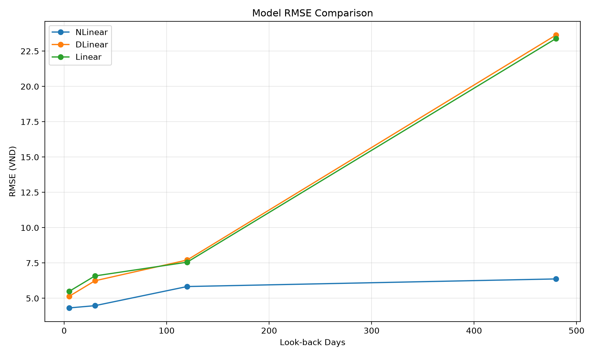
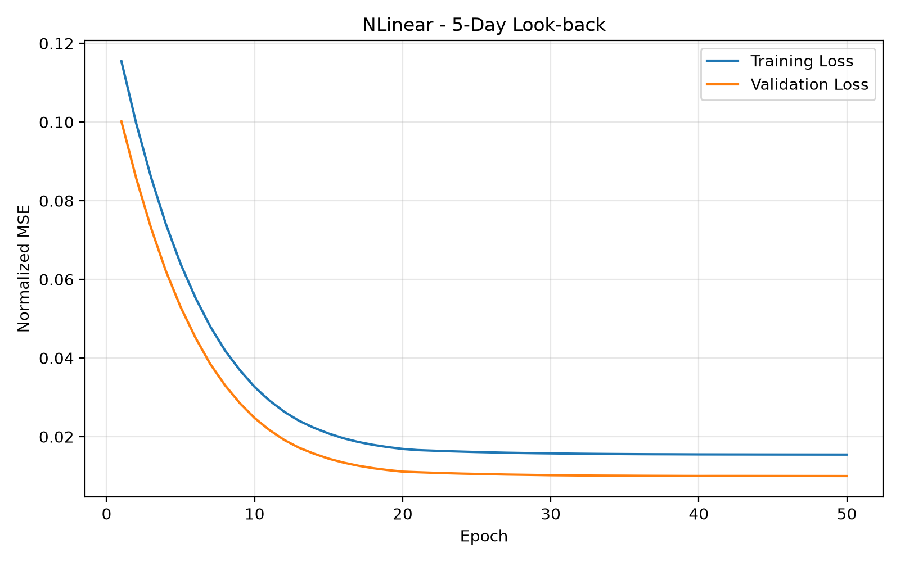
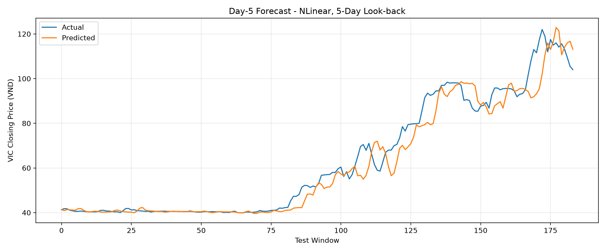
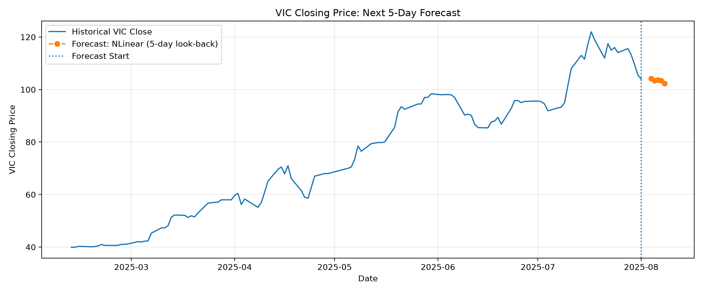

# VIC Stock Price Forecasting with LTSF-Linear Models

A time-series forecasting project for predicting the next 5 VIC stock closing prices using lightweight LTSF-Linear models.

The project compares **Linear**, **NLinear**, and **DLinear** across multiple historical look-back windows using chronological time-series splits, sliding-window preprocessing, model checkpointing, and experiment tracking.

## Overview

The forecasting setup includes:

- **Input:** Historical VIC closing prices
- **Look-back windows:** 5, 30, 120, and 480 trading days
- **Forecast horizon:** 5 future trading days
- **Models:** Linear, NLinear, DLinear
- **Evaluation metrics:** RMSE, MAE, R²

Closing prices are log-transformed and standardized before training. The scaler is fitted only on the training data to prevent data leakage, and predictions are transformed back to the original price scale for evaluation.


## Models

### Linear

The Linear model directly maps a historical sequence to the future forecasting horizon using a single linear layer.

```text
Historical Sequence
        ↓
   Linear Layer
        ↓
Future Predictions
```

### NLinear

NLinear re-centers each input sequence using its most recent observed value. The linear layer therefore learns relative changes rather than absolute price levels.

```text
Input Sequence
      ↓
Subtract Last Value
      ↓
Linear Layer
      ↓
Add Last Value Back
      ↓
Prediction
```

### DLinear

DLinear decomposes the input sequence into trend and seasonal components using a moving average. Each component is forecast separately before the outputs are combined.

```text
Input Sequence
      ↓
Moving Average Decomposition
      ↓
Trend + Seasonal Components
      ↓
Separate Linear Layers
      ↓
Combined Prediction
```

## Experiments

Each model is evaluated with four historical look-back windows:

| Look-back Window | Forecast Horizon |
| ---: | ---: |
| 5 days | 5 days |
| 30 days | 5 days |
| 120 days | 5 days |
| 480 days | 5 days |

This produces a total of:

```text
3 models × 4 look-back windows = 12 experiments
```

For each experiment, the project stores:

- Training and validation loss history
- Best model checkpoint
- Evaluation metrics
- Test-set predictions

## Results

The best-performing experiment in the current run is:

| Metric | Result |
| --- | ---: |
| Model | NLinear |
| Look-back Window | 5 days |
| RMSE | 4 |
| MAE | 2 |
| R² | 0.9714 |

### Model Comparison



### Training History



### Test Predictions



### Future Forecast




## Possible Improvements

- Add LSTM, GRU, and Transformer-based forecasting models
- Include OHLCV features and technical indicators
- Add early stopping
- Compare direct and recursive multi-step forecasting
- Build an interactive Streamlit application
- Support additional stock symbols

## Disclaimer

This project is intended for educational and research purposes only and should not be considered financial advice.